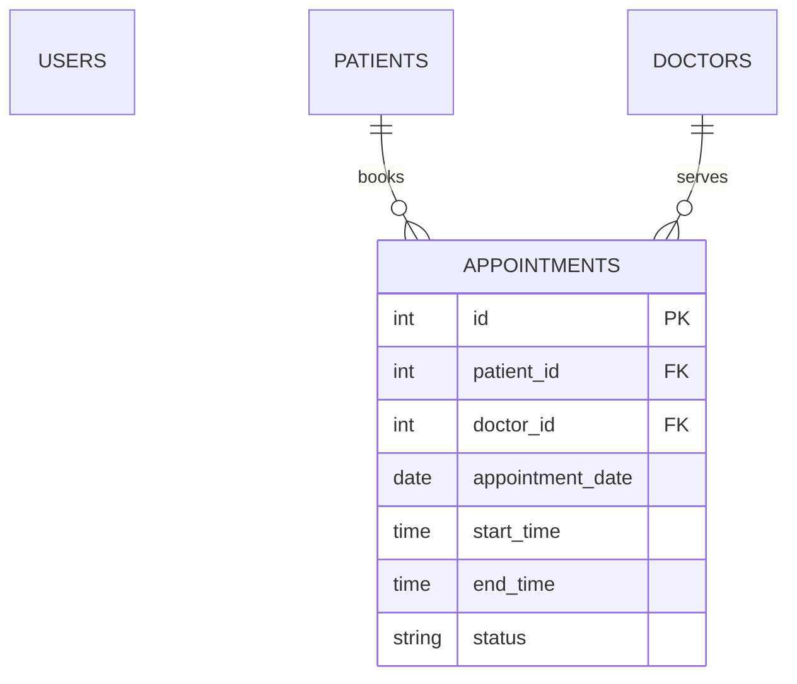

# Hospital Management System

MCA mini-project: a Java 17 Swing desktop application backed by MySQL. It provides BCrypt authentication, a sidebar dashboard, patient and doctor CRUD/search, appointment scheduling with time slots and statuses, and operational reports.

## Technologies and requirements

Java 17, Swing/AWT, Maven, MySQL 8+, JDBC, and jBCrypt are used. A Linux, macOS, or Windows machine with a graphical desktop and a reachable MySQL server is required.

## Architecture

`config` owns environment-backed database configuration; `model` contains records; `dao` contains JDBC persistence; `service` contains authentication/business services; `ui` contains Swing screens; `util` contains shared UI helpers.

## Setup

1. Install JDK 17+, Maven, and MySQL.
2. Run `database/schema.sql`, then `database/seed.sql`.
3. Copy `src/main/resources/config/application.properties.example` to `application.properties` (never commit that file), or set `DB_URL`, `DB_USER`, and `DB_PASSWORD`.
4. Build and launch:

```bash
mvn clean compile
mvn exec:java -Dexec.mainClass=com.hms.ui.Application
```

The seed creates a demo account `admin` / `password`; change it before use beyond a demo. No credentials are embedded in source code.

## Project structure

`src/main/java/com/hms/{config,model,dao,service,ui,util}` contains the layered application, `src/main/resources` contains configuration examples, `database` contains fresh-install SQL, and `docs` contains the report outline.

## Modules

- **Authentication:** username/password login with BCrypt verification.
- **Dashboard:** counts for patients, doctors, and appointments.
- **Patients:** create, edit, delete, search, and validate demographic/contact records.
- **Doctors:** create, search, and list active providers with license/contact/room details.
- **Appointments:** book date/time slots, validate time ranges and statuses, and prevent duplicate doctor slots.
- **Reports:** dashboard counts and appointment status summary.
- **Navigation:** sidebar modules and logout return to authentication.

Database constraints enforce required fields, foreign keys, enumerated statuses/genders, and a generated-column uniqueness constraint for active doctor time slots. See [docs/PROJECT_REPORT_OUTLINE.md](docs/PROJECT_REPORT_OUTLINE.md) for the MCA report structure. The legacy `lib` connector is retained for reference; Maven manages dependencies.

## Database relationship diagram



## Test cases

- Valid and invalid login credentials.
- Patient CRUD, ID/name/phone search, required fields, DOB, email, and phone validation.
- Doctor CRUD, license uniqueness, department, fee, availability, and contact validation.
- Appointment booking, past-date rejection, time-range validation, active duplicate-slot rejection, cancellation, rescheduling, and completion.
- Dashboard cards, today/upcoming appointments, filtered reports, and logout.

## Screenshots

Capture the Login, Dashboard, Patients, Doctors, Appointments, and Reports screens after configuring MySQL. Screenshots are intentionally not committed so the repository remains lightweight.

## Limitations

This is a desktop reference implementation: it requires a reachable MySQL server, has no remote API or automated database migration runner, and uses simple Swing dialogs rather than a production-grade form framework.

## Future enhancements

Role-based permissions, audit logs, printable invoices, richer charts, automated migrations, and a REST/mobile client can be added in a production version.

## Acknowledgement

The original repository was a tutorial-influenced console exercise. This implementation substantially reworks it into an educational MCA mini-project demonstrating Java Swing, JDBC, MySQL schema design, layered packages, validation, reporting, and BCrypt authentication.
